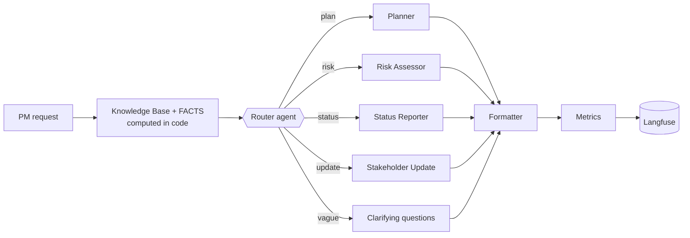
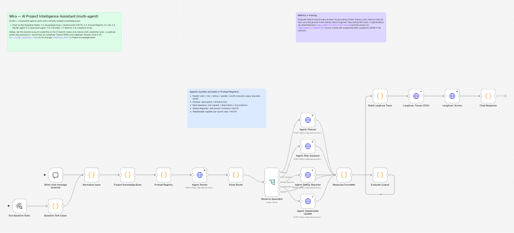
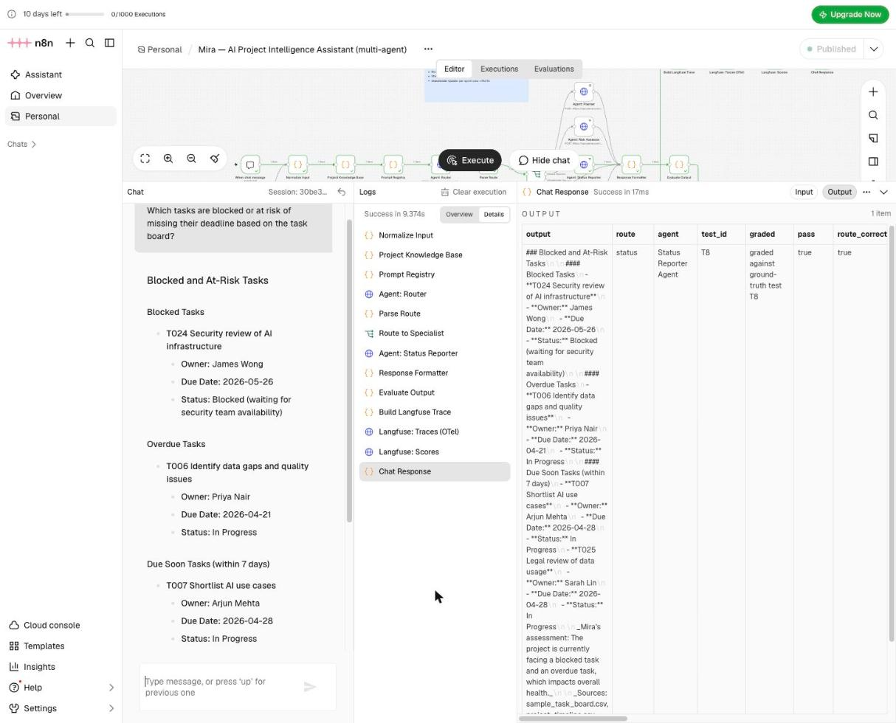
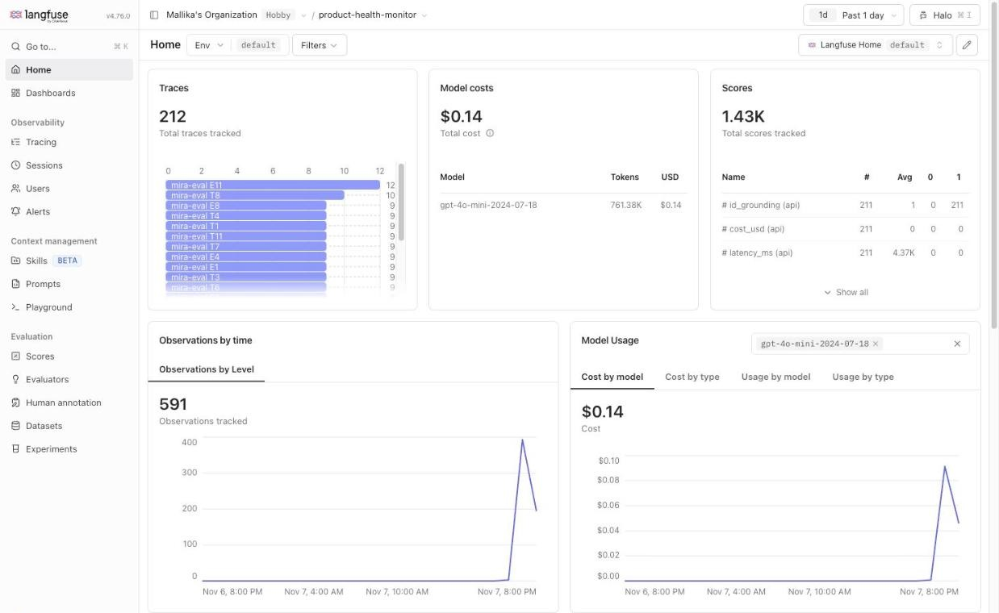
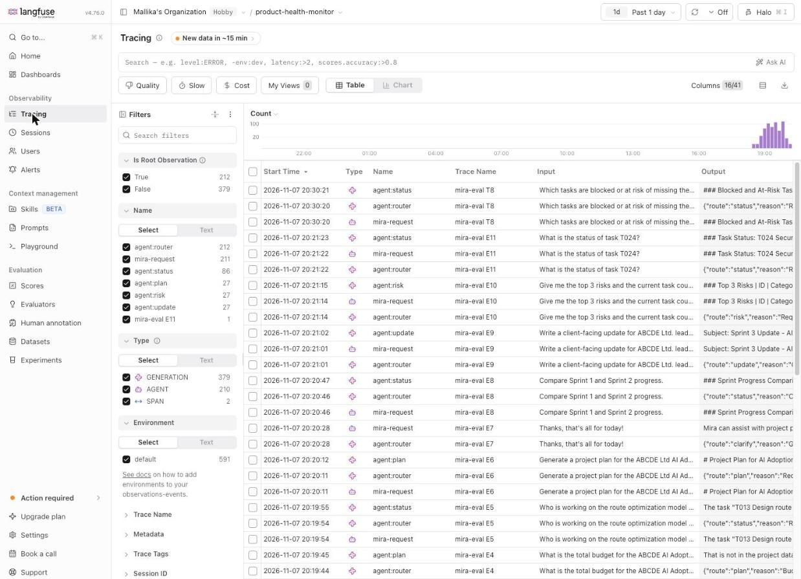
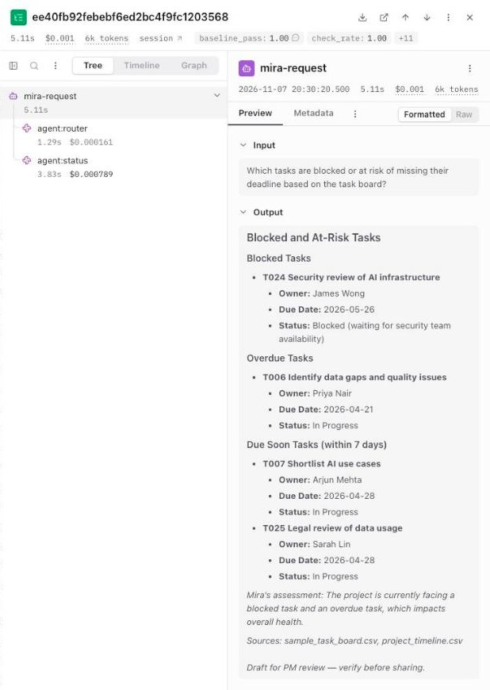
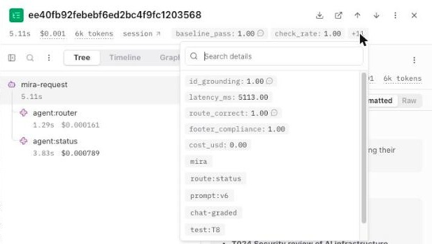

# Mira — AI-Powered Project Intelligence Assistant

**Interview Kickstart · Applied Agentic AI for PMs/TPMs · Capstone project**  
Author: Srinivas Annam · Stack: **n8n Cloud** (multi-agent workflow) · **OpenAI gpt-4o-mini** · **Langfuse** (tracing and evaluation)

Mira helps Nexora's PMs/TPMs run the ABCDE Ltd. AI Adoption Project. From the project's own files (description, timeline, risk register and task board) it generates:

- **project plans**
- **risk assessments**
- **weekly status reports**
- **stakeholder update emails**

Vague requests get clarifying questions instead of invented answers. Every request is traced and scored in Langfuse.



## Deliverables

| # | Deliverable | Where |
|---|---|---|
| 1 | BRD | [docs/01-BRD.md](docs/01-BRD.md) |
| 2 | PRD | [docs/02-PRD.md](docs/02-PRD.md) |
| 3 | Ground truth dataset | [docs/03-ground-truth-dataset.md](docs/03-ground-truth-dataset.md) · [eval/ground_truth.json](eval/ground_truth.json) · [eval/ground_truth.csv](eval/ground_truth.csv) |
| 4 | Metrics and their definitions | [docs/04-metrics.md](docs/04-metrics.md) |
| 5 | Metrics implementation | [docs/05-metrics-implementation.md](docs/05-metrics-implementation.md) · [eval/](eval/) · `Evaluate Output` / `Build Langfuse Trace` nodes |
| 6 | Extracted JSON of the system | [n8n/mira_workflow.json](n8n/mira_workflow.json) · [docs/06-n8n-workflow.md](docs/06-n8n-workflow.md) |
| 7 | Evaluation plan | [docs/07-evaluation-plan.md](docs/07-evaluation-plan.md) |
| 8 | Cost strategy | [docs/08-cost-strategy.md](docs/08-cost-strategy.md) |
| 9 | Reflection and next steps | [docs/09-reflection-and-next-steps.md](docs/09-reflection-and-next-steps.md) |
| 10 | README | this file |

**Problem-statement assignments (Q1–Q4) and submission items**

| Item | Where |
|---|---|
| Q1 Ideation: 3 use cases with pain point, solution, inputs/outputs, metrics, knowledge base | [docs/00-ideation.md](docs/00-ideation.md) |
| Q2 Build write-up (1–2 pages): architecture, orchestration, tools, capabilities, cost per plan, metrics | [docs/11-q2-build-writeup.md](docs/11-q2-build-writeup.md) |
| Q3 Program charter: vision, scope, success criteria, timeline, risks, stakeholders, decision-making, rollout | [docs/10-program-charter.md](docs/10-program-charter.md) |
| Q4 Reflection (1 page) | [docs/12-q4-reflection.md](docs/12-q4-reflection.md) · full version [docs/09](docs/09-reflection-and-next-steps.md) |
| Architecture diagram | Above, and [PRD §4](docs/02-PRD.md) |
| Baseline test results (all 12 inputs + 11 edge cases) | [results/variance_v6.md](results/variance_v6.md) (current, 69/69 over 3 runs) · [results/](results/) |
| Screenshots | [Below](#screenshots) |
| PDFs for upload (Q1–Q4, BRD, PRD) | [submission/](submission/) |

## Quick start

1. **Import** `n8n/mira_workflow.json` into n8n Cloud (*Workflows → Import from File*).
2. **Credentials:**
   - OpenAI API key on the 5 `Agent:` nodes.
   - Basic Auth (Langfuse public key / secret key) on `Langfuse: Traces (OTel)` and `Langfuse: Scores`.
   - The host is US (`us.cloud.langfuse.com`); for an EU project, change `langfuse_host` in *Project Knowledge Base*.
3. **Chat:** *Open chat* → "Which tasks are blocked or at risk of missing their deadline?"
4. **Evaluate:** click **Run Baseline Tests** → *Execute workflow*. That runs all 23 tests; results go to *Chat Response* and Langfuse. Or, from a terminal:
   ```bash
   export N8N_CHAT_URL="https://<you>.app.n8n.cloud/webhook/<id>/chat"   # Chat Trigger → Make Chat Publicly Available
   python3 eval/run_baseline.py --out results/baseline_v2.jsonl
   python3 eval/score.py results/baseline_v2.jsonl --md results/report_v2.md
   ```
5. **Prompt experiment:** set `PROMPT_VERSION = 'v1'` (or any of `'v2'`–`'v5'`) in *Prompt Registry*, re-run, then `python3 eval/score.py results/baseline_v1_run3.jsonl --compare results/baseline_v3_run2.jsonl`.

Full setup: [docs/06-n8n-workflow.md](docs/06-n8n-workflow.md).

## How it maps to the course

| Concept | Mandatory? | How Mira applies it |
|---|---|---|
| Multi-agent system design | Mandatory | Router + Planner, Risk Assessor, Status Reporter, Stakeholder Update, each with a strictly scoped knowledge base ([PRD §4.1](docs/02-PRD.md)) |
| Orchestration pattern | Mandatory | **Router / Dispatcher**, justified in [PRD §4](docs/02-PRD.md); hierarchical is the next step for multi-intent requests |
| Prompt engineering | Mandatory | Guide-style prompts (Global Context/Rules → Your Data → How to Answer → Boundaries) in [prompts/v6](prompts/v6); earlier versions down to the naive [v1](prompts/v1) kept — live experiment v1 52% → v2 65% → v3 96% → v5 98.6% → v6 100% (3 runs each) |
| Data grounding | Mandatory | KB built only from the 4 files; counts, dates and risk ranking computed in code; every T###/R## checked against the data on every request |
| Evaluation and observability | Mandatory | Langfuse traces (router + specialist generations, tokens, cost, latency) and scores; 23-test dataset with 151 checks |
| Human-in-the-loop | Extended | Every answer is a "Draft for PM review"; nothing is sent automatically |
| Extended capability | ≥ 1 required | **Stakeholder Update Generator** (leadership / engineering / client) |
| Fine-tuning | Extended | Plan in [reflection §4](docs/09-reflection-and-next-steps.md) |

## Lifecycle

**Review** (problem statements, chose Mira) → **Select** (Mira: TPM-core, data provided, no OAuth) → **Plan** (BRD) → **Design** (PRD, agents, KB scoping) → **Build** (n8n workflow generated from versioned sources) → **Execute** (chat and one-click test run) → **Evaluate/Optimize** (scores in Langfuse, `score.py`, prompt experiments) → **Test** (baseline + 11 edge cases) → **Document** (this repo) → **Submit**.

## Repository layout

```
data/                 source files from the problem statement (description, timeline, risks, task board, eval inputs)
prompts/v6 … v1      system prompts (v6 current, v2 first production, v1 naive baseline)
n8n/mira_workflow.json  the importable workflow (generated)
n8n/src/*.js          Code-node sources (knowledge base + FACTS, router parsing, formatter, metrics, Langfuse trace)
tools/build_workflow.py  rebuilds the workflow JSON from data + prompts + src + ground truth
eval/                 ground truth, check engine, run_baseline.py, score.py, compute_expected.py
tests/                offline harness (runs the workflow logic in Node), JS/Python parity tests, fixtures
docs/                 deliverables 1–9, plus Q1 ideation (00), program charter (10), Q2 write-up (11), Q4 one-page reflection (12)
screenshots/          n8n canvas, Mira chat, Langfuse dashboard and traces
results/              live run outputs (jsonl), scored CSVs, reports, prompt experiment
```

## Verification status

- ✅ Workflow logic: `node tests/run_workflow_offline.js` (23/23 routed and scored; FACTS correct) and `node tests/run_workflow_offline.js bad` (all 7 bad answers caught)
- ✅ Check engines: `python3 tests/test_checks.py` (JS ⇄ Python parity on 29 fixture answers; FACTS = independent Python computation)
- ✅ Real n8n 1.123: imported and executed end to end against mock OpenAI/Langfuse; chat webhook + `run_baseline.py` + `score.py` loop works
- ✅ **Live on n8n Cloud with gpt-4o-mini:** prompt v6, run three times (69 chat requests): **69/69 pass, 69/69 routing, 0 fabricated IDs, 3.2 s median / 4.4 s average and ~$0.00066 per request** — [results/variance_v6.md](results/variance_v6.md); v5 (68/69) in [results/variance_v5.md](results/variance_v5.md); v3 → v4 review in [results/chat_run_2026-11-07.md](results/chat_run_2026-11-07.md); v1 → v2 → v3 experiment in [results/prompt_experiment.md](results/prompt_experiment.md)
- ✅ Langfuse (US, v4 OpenTelemetry ingestion): every chat run logs a trace with router + specialist generations and 7 scores

Everything in `eval/` and `tests/` uses only the Python 3 standard library and Node.js; no installs are needed.

## Key assumptions

- **Reporting date 2026-04-24** and **week 1 = 2026-03-30**. The board's due dates are April–August 2026. Both are editable in `CONFIG`.
- **Counts follow the CSV.** The problem statement says "3 Done"; the board has 5.
- **Top risks are ranked by live task evidence** (blocked > overdue > due soon), because the register has no likelihood or severity scores.

## Screenshots

**n8n workflow canvas** — router, four specialist agents, metrics and the two Langfuse nodes:



**Mira in action** — test T8 asked in the n8n chat. Mira finds T024 blocked, T006 overdue, and T007/T025 due soon; the output panel shows route `status`, test `T8`, graded, `pass: true`:



**Langfuse dashboard** — 212 traces, model cost, and scores (id_grounding averages 1.0 across 211 traces):



**Langfuse traces** — every request is a `mira-request` trace with an `agent:router` generation and a specialist generation:



**One trace (T8)** — router 1.29 s / $0.00016 and Status Reporter 3.83 s / $0.00079, the full answer, and its scores (baseline_pass 1.00, check_rate 1.00, id_grounding 1.00, route_correct 1.00, footer_compliance 1.00) and tags (`prompt:v6`, `test:T8`):



