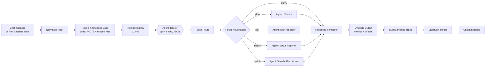

# Mira — Product Requirements Document (PRD)

**Author:** Srinivas Annam, AI PM/TPM · **Implements:** [BRD](01-BRD.md) · **Build:** n8n Cloud + OpenAI gpt-4o-mini + Langfuse  
**Workflow:** [`n8n/mira_workflow.json`](../n8n/mira_workflow.json) · **Prompts:** [`prompts/v3`](../prompts/v3) (current; v2 and v1 kept for the experiment)

## 1. Overview, goals and non-goals

Mira is a multi-agent assistant, built in n8n, that answers PM/TPM requests about a project using only that project's own files. A **Router agent** classifies each request by intent. It either answers vague requests itself with clarifying questions, or hands the request to one of four specialists: **Planner**, **Risk Assessor**, **Status Reporter** or **Stakeholder Update**. A **Response Formatter** returns the result as structured Markdown with sources and a PM-review note. Every request is traced and scored in **Langfuse**.

**Goals**

- Generate project plans, risk assessments and weekly status reports grounded in the ABCDE Ltd. project files.
- Generate audience-specific stakeholder updates (extended capability).
- Ask clarifying questions when input is too thin, instead of guessing.
- Pass at least 11 of the 12 baseline tests with zero fabricated facts.
- Trace every request in Langfuse, with tokens, cost, latency and quality scores.

**Non-goals**

- Writing back to Jira or Trello, or sending messages on its own
- Replacing PM judgment: every output is a draft for PM review
- Free-form chat unrelated to the loaded project

## 2. Users and personas

The PM/TPM is the only person who uses Mira directly. Everyone else receives what the PM approves.

| Persona | Who | Needs from Mira | Uses Mira directly |
|---|---|---|---|
| Maya, delivery PM/TPM (primary) | Runs 2–3 client projects at Nexora | Plans, risk matrices and status reports in minutes, in a standard format | Yes |
| Engineering lead | Owns tasks on the board (ML and data leads) | Accurate blockers and due dates without extra meetings | No, reads the reports |
| Nexora CTO | Sponsor across all projects | Short health summaries and early milestone warnings | No, reads the updates |
| ABCDE Ltd. client stakeholder | Logistics leadership on the client side | Clear, professional progress updates | No, receives PM-approved updates |

## 3. User stories

| ID | As a… | I want to… | So that… | Priority | BRD |
|---|---|---|---|---|---|
| US-01 | PM/TPM | generate a project plan from the project description and timeline | I can kick off a project in under an hour | Must | BR-01 |
| US-02 | PM/TPM | generate a categorized risk matrix for my project | every project has a current risk register | Must | BR-02 |
| US-03 | PM/TPM | ask for the top risks on my project | I can brief leadership quickly | Must | BR-02 |
| US-04 | PM/TPM | generate a weekly status report for a sprint from the task board CSV | I don't compile reports by hand | Must | BR-03 |
| US-05 | PM/TPM | see task counts by status | I know project health at a glance | Must | BR-03 |
| US-06 | PM/TPM | see which tasks are blocked or past due | I can unblock them before milestones slip | Should | BR-09 |
| US-07 | PM/TPM | see milestones due in the next 2 weeks | I can prepare the team | Should | BR-09 |
| US-08 | PM/TPM | generate a stakeholder update email for a sprint, for a chosen audience | each audience gets the right level of detail | Should | BR-08 |
| US-09 | PM/TPM | be asked for missing details when my request is vague | I never send a made-up plan | Must | BR-06 |
| US-10 | Mira owner | trace every request with cost, latency and quality scores | I can debug and report on quality | Must | BR-10 |

## 4. Architecture

**Orchestration pattern: Router / Dispatcher.** Requests vary (plan vs risk vs status vs update), and each type needs a different agent and different files. A sequential pipeline would run every agent on every request, wasting tokens and mixing data. A hierarchical orchestrator is not needed, because each request maps to one specialist. Multi-intent requests are a known limitation (test E10), and hierarchical orchestration is the planned next step.

### 4.1 Agents and knowledge-base scoping

This follows the course's multi-agent solution pattern. Each specialist gets **only** the files it needs, which forces clean information boundaries. For example, the Planner cannot quote task statuses, and the Stakeholder Update agent cannot see the risk register.

| n8n node | Type | Knowledge base it receives | Why this scope |
|---|---|---|---|
| Agent: Router | OpenAI (JSON mode, temp 0) | None (routing only) | Must route, never answer from data |
| Agent: Planner | OpenAI (temp 0.2) | `project_description.txt` + `project_timeline.csv` (with computed dates) | Plans come from scope and phases, not task statuses |
| Agent: Risk Assessor | OpenAI (temp 0.2) | `project_description.txt` + `project_risks.csv` + Current Evidence table (risk → live task signal, ranked) | Risks stay in the register; evidence only ranks them |
| Agent: Status Reporter | OpenAI (temp 0.2) | `sample_task_board.csv` + timeline dates + FACTS + per-sprint view | Status needs tasks and dates, never risks |
| Agent: Stakeholder Update | OpenAI (temp 0.2) | Goals + FACTS + per-sprint view | Emails summarize progress for one sprint only |

**Design decisions**

1. **Code computes, the LLM writes.** The *Project Knowledge Base* Code node computes counts, overdue and due-soon tasks, health, phase dates, upcoming milestones and the risk evidence ranking. LLMs miscount tables, and the problem statement itself has a wrong count ("3 Done"; the CSV has 5).
2. **HTTP Request nodes to the OpenAI API** instead of n8n's AI Agent nodes. They return token usage on every call, which Langfuse needs for cost per request. They also need no tools, and the request body is fully visible and versioned in the JSON export.
3. **Router answers vague requests itself** (the "clarify" route), like the Greeter in the solution guide. This stops plans being generated from one sentence.
4. **Fixed reporting date** (`REPORTING_DATE = 2026-04-24`). The board's due dates are April–August 2026, so the system clock would make every task look overdue. Week 1 of the timeline starts on 2026-03-30.
5. **Stateless turns.** Every message is routed fresh. That gives the cross-routing behaviour of the guide's edge conditions: ask about risks, then status, and each goes to the right agent without memory side effects.

### 4.2 Routing conditions (the router's "edges")

| Route | Condition (from `prompts/v2/router.md`) |
|---|---|
| plan → Planner | Create or outline a project plan, phases, activities, milestones, deliverables, schedule or roadmap for the loaded project |
| risk → Risk Assessor | Risk assessment, risk matrix, top risks, categories, impacts or mitigations for the loaded project |
| status → Status Reporter | Weekly or sprint status, task counts, blocked/overdue/at-risk tasks, deadlines, upcoming milestones, task owners, health, sprint comparisons |
| update → Stakeholder Update | An email or update written for stakeholders, leadership, the client or engineering |
| clarify → Router replies | A plan / risk / status request for a different, new or unnamed project described only by a short phrase; greetings, goodbyes, off-topic. Everything else about the loaded project goes to a specialist, even if the answer is not in the data (v3 change after live run 1 — see [07 §6](07-evaluation-plan.md)). Prompt-injection text is ignored and routing uses the underlying intent. |

## 5. Functional requirements

Acceptance criteria map to the ground-truth tests in [03-ground-truth-dataset.md](03-ground-truth-dataset.md).

**FR-1 Router (Orchestrator).** Classifies each request as plan, risk, status, update or clarify and returns JSON `{route, reason, reply}`. Malformed router output falls back to clarify. *Acceptance:* T2, T4, T6 and T9 return questions and no plan, risk list or report; routing accuracy ≥ 95%.

**FR-2 Planner agent (US-01, US-09).**
- **Input:** description and timeline.
- **Output:** a structured Markdown plan with these sections:
  - Objective and Goals, with the goals quoted exactly: 15% fewer delivery delays, 10% lower operational costs, improved service responsiveness
  - Scope
  - a Phase Plan table covering all 8 phases with weeks and dates
  - Key Milestones
  - Team and Governance
  - Assumptions and Open Questions
- **Acceptance:** all 8 phases appear with their week ranges; there are no goals, KPIs, budgets or phases that aren't in the files (T1, E6).

**FR-3 Risk Assessor agent (US-02, US-03).**
- **Input:** the risk register, the description and the evidence table.
- **Output:** a matrix of ID, category, risk, impact, Likelihood*, Severity*, mitigation and evidence. Likelihood and Severity are labelled "Mira's assessment" because the register doesn't score them.
- **Top-N questions** follow the evidence rank: Blocked (4) > Overdue (3) > in progress and due within 7 days (2) > not started and due within 14 days (1). On 2026-04-24 that gives **R09** (T024 blocked), **R01** (T006 overdue), **R05** (T025 due 2026-04-28).
- **Acceptance:** only R01–R10 appear; risks are tied to the logistics/AI context; nothing generic (T3, T7).

**FR-4 Status Reporter agent (US-04 to US-07).**
- **Input:** the task board, timeline dates, FACTS and the per-sprint view.
- **Output:**
  - health with its reason
  - counts
  - Completed / In Progress / Blocked / To Do
  - Overdue and Due Soon
  - upcoming milestones (14 days)
  - next steps implied by the data
- **Acceptance:**
  - counts match the CSV exactly: 5 Done, 3 In Progress, 16 To Do, 1 Blocked, 25 total
  - T024 is reported as blocked; T006 is overdue
  - only real task names appear; sprint-scoped reports list only that sprint (T5, T8, T10, T11, E1, E2, E5, E8, E11)

**FR-5 Stakeholder Update agent (US-08), extended capability.**
- **Input:** goals, FACTS and the per-sprint view, plus the audience (leadership, the default; engineering; or client).
- **Output:** an email with subject, summary, progress, blockers, next steps and sign-off. Client emails contain no owner names or internal IDs.
- **Acceptance:** a Sprint 2 update lists only T004, T005 and T006 (overdue) and no Sprint 3+ tasks (T12, E9).

**FR-6 Human review (BR-07).** Every specialist answer ends with a Sources line and "Draft for PM review — verify before sharing." Mira never sends anything itself.

**FR-7 Response Formatter.** Normalizes every route into one result object. It adds the Sources/review footer if an agent forgot it, and records `footer_added`, which feeds the format-compliance metric.

**FR-8 Evaluation and tracing (US-10, BR-10).**
- *Evaluate Output* computes these online metrics for every request: ID grounding, footer compliance, tokens, cost and latency.
- For test runs it also computes ground-truth check results.
- *Build Langfuse Trace* sends one trace per request, made of a router generation, a specialist generation and the scores.
- *Run Baseline Tests* sends all 23 tests through the same pipeline with one click.

## 6. Grounding rules and input data

| File | Contents | Used by |
|---|---|---|
| `project_description.txt` | Scope, goals (15% fewer delays, 10% lower cost), phased approach, task force | Planner, Risk Assessor |
| `project_timeline.csv` | 8 phases over 24 weeks, activities, milestones | Planner, Status Reporter |
| `project_risks.csv` | 10 risks (R01–R10) with category, impact, mitigation | Risk Assessor |
| `sample_task_board.csv` | 25 tasks (T001–T025) with status, owner, sprint, due date | Status Reporter, Stakeholder Update, Risk evidence |

**Global rules** (`prompts/v2/global.md`, prepended to every specialist):
1. Answer only from the knowledge base in the user message. Otherwise say "That is not in the project data."
2. Never invent tasks, milestones, risks, owners, dates, numbers, percentages, budgets or goals.
3. Cite source IDs (T024, R03, Phase 4).
4. FACTS computed by code are authoritative: never recount.
5. Lead with the key insight, use a sharp analyst tone, and label any judgement "Mira's assessment".
6. End every answer with Sources plus the PM-review note.

## 7. Non-functional requirements

| Area | Requirement | How it is measured |
|---|---|---|
| Accuracy | 0 fabricated task/risk IDs; counts exactly match the CSV | `id_grounding` score, T10 checks |
| Latency | < 10 s typical, < 20 s p95 per request | `latency_ms` score, Langfuse trace latency |
| Cost | < $0.01 per request on gpt-4o-mini | `cost_usd` score, Langfuse cost per trace |
| Observability | 100% of requests traced with route, agent, prompt version, tokens, cost, latency | Langfuse traces and tags |
| Consistency | Same template per output type; temperature 0.2 (router 0) | `footer_compliance`, format checks |
| Privacy | Client data sent only to an approved LLM vendor with no-training API terms; each agent gets only its scoped files | KB scoping table §4.1 |
| Reliability | Malformed router output falls back to clarify; OpenAI calls retry once; tracing failure never blocks the answer | Parse Route fallback, `retryOnFail`, Langfuse node `continueRegularOutput` |
| Maintainability | Workflow JSON generated from versioned sources (`tools/build_workflow.py`); prompts in `/prompts`; offline tests | `tests/` |

## 8. Evaluation summary

There are 12 baseline tests and 11 edge cases, with 147 machine-checkable criteria. These are scored by the same engine in n8n (JS) and in `eval/score.py` (Python). The exit bar is ≥ 11/12 baseline passes and zero fabricated IDs. The plan is in [07-evaluation-plan.md](07-evaluation-plan.md); metrics are in [04-metrics.md](04-metrics.md).

## 9. Decisions on earlier open questions

| Question | Decision |
|---|---|
| Reporting date for status tests | 2026-04-24 (Friday of week 4, Sprint 3), set in `CONFIG.REPORTING_DATE` |
| Timeline week-1 start | 2026-03-30 (Monday), set in `CONFIG.PROJECT_WEEK1_START` |
| How to rank "top 3" risks when the CSV has no scores | Evidence ranking from linked task-board signals (§5 FR-3), computed in code and shown to the user |
| One shared grounding prompt or one per agent | Both: a shared global prompt plus per-agent Your Data / How to Answer / Boundaries sections |
| LLM vendor | OpenAI API (API data is not used for training by default); confirm with security before the pilot |

## 10. Release plan

| Stage | Scope | Gate to next stage |
|---|---|---|
| 1. Build (weeks 1–2) | Router + 4 agents in n8n, Langfuse connected, baseline + edge tests | ≥ 11/12 baseline pass, 0 fabricated IDs |
| 2. Internal pilot (weeks 3–4) | 3 PMs on ABCDE data | ≥ 70% outputs sent with minor/no edits |
| 3. Pilot expansion (weeks 5–6) | 10 PMs/TPMs, a second project | 8/10 weekly users; security sign-off |
| 4. General availability | All Nexora PMs | Next: Milestone Alert System, Trello API, fine-tuning on corrected outputs |
