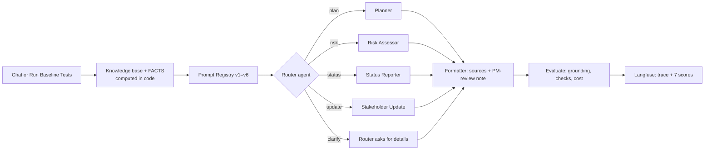

# Q2 — Building Mira (write-up)

**Author:** Mallika Annam · **Stack:** n8n Cloud · OpenAI gpt-4o-mini · Langfuse (OpenTelemetry) · **Full detail:** [PRD](02-PRD.md), [workflow](06-n8n-workflow.md), [evaluation](07-evaluation-plan.md), [cost](08-cost-strategy.md)

## Design and architecture

**Orchestration: Router / Dispatcher.** PM requests are one of four kinds (plan, risk, status, stakeholder update), and each needs different data. A router sends each request to one specialist:
- **Lower cost than a sequential pipeline:** a clarify answer costs $0.00019, a full plan $0.00077.
- **Easy to trace:** two LLM calls per request, router then specialist.
- **One agent per pain point**, each with its own prompt.

The rejected options:
- **Sequential pipeline:** runs every agent on every request, so it wastes cost.
- **Hierarchical:** only needed for multi-part requests (E10), and is next on the roadmap.

**Agents and grounding.** Each agent sees only its own slice of the data:
- **Planner:** description and timeline.
- **Risk Assessor:** risk register, plus a ranking of risks by live task evidence.
- **Status Reporter:** task board, timeline and per-sprint facts.
- **Stakeholder Update:** goals and per-sprint view.

Counts, overdue and due-soon tasks, health, milestone dates and risk ranking are **computed in JavaScript, not by the LLM**. The prompts tell the model to use those facts as given.

**Human review.** Every answer ends with its sources and "Draft for PM review", and nothing is sent automatically.

**Tool choices**

| Need | Choice | Why |
|---|---|---|
| Workflow platform | n8n Cloud | Low-code, visual, exportable JSON; Code nodes for deterministic facts |
| LLM | gpt-4o-mini | ~$0.00066 per request; JSON mode for the router; good enough once facts come from code |
| LLM calls | HTTP Request nodes (not the AI Agent node) | Returns token usage for cost tracking; no tools needed |
| Observability | Langfuse (US region, OpenTelemetry) | One trace per request with router and specialist generations, tokens, cost, latency and 7 scores |
| Evaluation | Ground-truth JSON + one check engine in JS (n8n) and Python (`score.py`) | The same checks run inside the live workflow and offline |

## Implementation

| Capability | Status | Evidence (live, v6) |
|---|---|---|
| Project plan (core) | ✅ | T1: 8 named phases, dates, milestones; goals quoted exactly |
| Risk assessment (core) | ✅ | T3: all 10 register risks categorized with mitigations; T7: top 3 by evidence (R09, R01, R05) |
| Weekly status report (core) | ✅ | T5: Sprint 3 only, real task names, Phase 2 milestone; T8: T024 blocked, T006 overdue |
| Stakeholder Update Generator (extended) | ✅ | T12 leadership email (Sprint 2 only); E9 client email without owner names |
| Vague-input handling | ✅ | T2, T4, T6, T9 ask for scope, goals, timeline and team; no invented plan |
| Observability | ✅ | Every request traced in Langfuse; scores: id_grounding, footer, cost, latency, baseline_pass, check_rate, route_correct |
| Baseline dataset | ✅ | All 12 inputs + 11 edge cases, 151 checks; results in [`results/`](../results) |

## Cost and evaluation

**Cost per request** (measured over 3 runs, gpt-4o-mini list prices):

| Request | Cost | Latency |
|---|---|---|
| **Project plan** | **$0.00077** | 10.5 s |
| Risk assessment | $0.00097 | 12.8 s |
| Sprint status report | $0.00106 | 8.5 s |
| Stakeholder email | $0.00063 | 3.9 s |
| Clarifying question | $0.00019 | 1.8 s |
| **Average, all 69** | **$0.00066** | 4.4 s (median 3.2 s) |

At 100 requests per PM per month, that is about $0.07 per PM, far below the $5 target. The 23-test suite costs $0.015 to run.

**Metrics** (definitions in [04-metrics.md](04-metrics.md)):

| Metric | Target | v1 naive | v3 | **v6 (3 runs)** |
|---|---|---|---|---|
| Baseline pass rate (T1–T12) | ≥ 11/12 | 7/12 | 12/12 | **36/36** |
| All-tests pass rate | — | 52% | 96% | **69/69 (100%)** |
| Routing accuracy | ≥ 95% | 78% | 100% | **100%** |
| Fabricated IDs | 0 | 0 | 0 | **0** |
| Cost per request | < $0.01 | $0.00067 | $0.00062 | **$0.00066** |

**Observations**
1. **Facts computed in code prevent fabricated data.** Even naive v1 prompts never invented an ID. But only prompt boundaries stopped the misuse of real data: v1 adopted a user's 30% goal and put owner names in a client email.
2. **The router can't see the data, so it must be told the data exists.** v2 over-asked for clarification on 6 answerable status questions. The v3 router prompt fixed this: routing went from 74% to 100%.
3. **Passing checks can hide wrong answers.** Reading every answer found T10 missing the Blocked count and T5 mixing project and sprint health. The checks were tightened. T5 was fixed only once per-sprint facts were computed in code; the prompt alone was not enough.
4. **One run is not enough.** Three runs of v5 showed T1 dropping phase names 1 time in 3. A one-line rule (v6) fixed it, and v6 passed 69/69.
